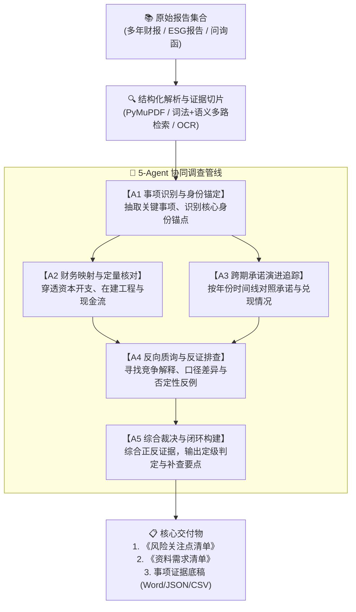

# 审迹智链 (AuditTrace)

> **面向多期跨报告的证据链调查与智能鉴证系统**  
> *Cross-Report Evidence Tracing & Intelligent Assurance System for Multi-Year Disclosures*

[](https://fastapi.tiangolo.com/)
[](https://www.python.org/)
[](#-系统架构五agent闭环协同)
[](https://www.docker.com/)
[](PROJECT_LICENSE.md)

---

## 📌 项目简介

**审迹智链 (AuditTrace)** 是一款面向可持续发展信息鉴证、跨期披露一致性核验与企业潜在合规风险调查的多智能体系统。

在实际鉴证与审计实践中，企业经常就同一重大事项（如“零碳转型”、“巨额环保投资”、“重大研发承诺”）在不同报告（年度财务报告、ESG/可持续发展报告、社会责任报告、监管问询函）中进行分散披露。传统人工核对不仅工作量巨大，且极易面临**跨报告口径不一**、**定性口号与财务数据脱节**以及**缺少审计底稿级溯源证据链**等痛点。

系统在详细鉴证程序实施前，依托**5-Agent 闭环协同与反证门禁机制**，穿透多年份、多源头的文本与财务报表，自动追踪事项脉络、财务影响与跨期承诺演进，最终为项目组生成**《风险关注点清单》**、**《资料需求清单》**与**事项全景证据档案**，辅助专业人员高效做出鉴证决策。

---

## 💡 核心痛点与解决思路

```
┌─────────────────────────────────────────────────────────────┐
│                       传统核验痛点                          │
├──────────────────────────────┬──────────────────────────────┤
│ ❌ 跨报告口径冲突            │ 年报与ESG报告披露同一项目，  │
│                              │ 但投资额、进展与分类相互矛盾 │
├──────────────────────────────┼──────────────────────────────┤
│ ❌ 定性口号与定量财务脱节    │ ESG 报告声称数十亿低碳投入， │
│                              │ 财报在建工程/资本开支无实证  │
├──────────────────────────────┼──────────────────────────────┤
│ ❌ 大模型幻觉与不可解释      │ 现有 AI 工具输出结论无出处， │
│                              │ 无法作为合规或底稿依据       │
└──────────────────────────────┴──────────────────────────────┘
                              ▼
┌─────────────────────────────────────────────────────────────┐
│                     审迹智链解决思路                        │
├──────────────────────────────┬──────────────────────────────┤
│ ✔ 全量证据溯源               │ 精确映射至报告名、原页码与   │
│                              │ 句子级 Quote，具备防篡改指纹 │
├──────────────────────────────┼──────────────────────────────┤
│ ✔ 财务桥接与条件试算         │ 区分在建工程、资本开支与现金 │
│                              │ 流，禁止盲目相加，设严格门禁 │
├──────────────────────────────┼──────────────────────────────┤
│ ✔ 引入反向质询角色 (A4)      │ 专门寻找反证、边界与竞争解释 │
│                              │ 抑制确认偏差，杜绝 AI 盲目迎合│
└──────────────────────────────┴──────────────────────────────┘
```

---

## 🏗️ 系统架构：五 Agent 闭环协同

审迹智链构建了分工明确、带严格反证检验的 5-Agent 多智能体协同管线：



### 智能体角色分工
1. **A1 - 事项识别智能体 (Matter Identifier)**：解析企业多年多份披露，提取具有财务或合规重要性的核心事项（如绿色工厂改造、重大减排工程），建立唯一身份锚点。
2. **A2 - 财务影响智能体 (Financial Bridge)**：将事项与财报附注深度关联，核验披露金额是否在固定资产、在建工程、研发费用或现金流量表中真实入账。
3. **A3 - 跨期追踪智能体 (Timeline Tracker)**：跨越 2~5 年时间跨度，纵向追踪历史承诺、当年进展与未来目标的演化与延期情况。
4. **A4 - 反向审计智能体 (Adversarial Auditor)**：**系统的核心防幻觉与防偏设计**。专门寻找反面证据、行业对标矛盾、母子公司披露边界差异与备择解释，推翻缺乏实据的乐观论断。
5. **A5 - 综合决策智能体 (Evidence Synthesizer)**：汇总 A1~A4 报告与证据链，进行加权裁决，生成结构化结论与后续调查指引。

---

## ✨ 核心特性

- **🔍 原文级精准可追溯（Evidence Provenance）**：所有提取的数值和事实均绑定 `document_id`、`pdf_page`、`quote` 文本切片及 SHA-256 哈希值，支持在前端一键定位高亮原文。
- **🛡️ 严格会计约束与条件试算**：坚守会计专业底线。在建工程期末余额、本期资本开支与购建现金流严禁机械相加；一切测算均附带证据前提与不可比声明。
- **🌐 全面兼容主流 LLM / 本地模型**：基于标准 OpenAI 兼容协议开发，支持 **DeepSeek**（官方接口）、**OpenAI**（GPT-4o/mini）、**通义千问 (Qwen)**、**智谱 GLM** 以及本地私有化部署的大模型（如 **vLLM / Ollama**）。
- **📊 交付物多格式同源导出**：一键生成符合专业审计底稿标准的 Word (.docx) 文档，同时支持导出 JSON 与 CSV 结构化数据，确保数据一致性。
- **🚀 零门槛快速演示体验**：提供 `AUDITTRACE_SINGLE_USER=true` 演示模式，支持评委与访客开箱即用，免去登录配置和配额限制。

---

## 🚀 快速上手

### 方式一：Docker 一键部署（推荐）

需已安装 [Docker](https://www.docker.com/) 和 Docker Compose：

```bash
# 1. 复制配置文件
cp .env.example .env

# 2. 启动容器服务
docker compose up -d

# 3. 访问系统
# 浏览器打开: http://127.0.0.1:8877
```

---

### 方式二：本地脚本一键启动

#### Windows 用户：
双击运行仓库根目录下的 `start.bat`，脚本将自动检查依赖并启动服务。

#### Linux / macOS 用户：
```bash
chmod +x start.sh
./start.sh
```

---

### 方式三：手动分步启动

```bash
# 1. 安装核心运行依赖
pip install -r requirements.txt

# 2. 初始化本地企业知识库与元数据
python -m backend.app.connectivity_bootstrap --allow-missing-sources

# 3. 启动应用服务
python -m uvicorn backend.app.connectivity_app:app --host 127.0.0.1 --port 8877
```

启动完成后，打开浏览器访问 **`http://127.0.0.1:8877/`** 即可进入系统工作台。

---

## ⚙️ 模型与环境配置 (`.env`)

在项目根目录创建 `.env` 文件（可参考 [.env.example](.env.example)），配置您的模型密钥：

```ini
# [推荐] 使用 DeepSeek
DEEPSEEK_API_KEY=your_deepseek_api_key
DEEPSEEK_BASE_URL=https://api.deepseek.com
DEEPSEEK_MODEL=deepseek-flash

# [可选] 使用 OpenAI 或其他兼容接口（如通义千问、智谱、vLLM）
# OPENAI_API_KEY=your_key_here
# OPENAI_BASE_URL=https://api.openai.com/v1
# OPENAI_MODEL=gpt-4o-mini
AUDITTRACE_ALLOW_ANY_PROVIDER=true

# 演示模式开关（适合评委无登录评审）
AUDITTRACE_SINGLE_USER=true
AUDITTRACE_DEMO_TASK_PERSISTENCE=local
```

---

## 🎯 跨赛道与场景扩展迁移 (Domain Adaptation)

审迹智链的底层能力是**“非结构化文档交叉证据挖掘 + 跨期承诺跟踪 + 反向审计质询”**，不仅适用于数智会计，还可灵活迁移至以下高价值场景与赛事：

| 迁移赛道 / 场景 | 核心应用逻辑 | 迁移改动要点 |
| :--- | :--- | :--- |
| **🌱 ESG 漂绿（Greenwashing）识别** | 对照企业可持续发展报告中的宏大减排宣示与年报真实资本开支，排查是否存在“言过其实”的夸大披露。 | 扩充 ESG 判定准则词库与绿色指标抽取规则。 |
| **📑 IPO 招股书与问询函穿透** | 对比多轮申报稿与监管问询回复，识别前后口径不一、供应商客户重合、关键业务模式修饰等潜在风险。 | 适配招股说明书与交易所问询函的章节切片模板。 |
| **🔍 财务舞弊与内控穿透** | 纵向扫描 3~5 年财报，核验研发支出资本化合理性、大额预付款跨期挂账、关联方资金占用等隐匿线索。 | 引入法务会计规则库与异常财务比率触发器。 |
| **🏦 金融信贷与债项合规排查** | 银行或评级机构在放贷与存续期管理中，自动核查发债主体资金募集用途与实际项目进度的偏离度。 | 接入募集说明书与资金使用专项核查报告。 |

---

## 🔬 实验与基准评测 (Benchmarking)

系统内置了标准化的消融实验与对照评估脚本，可一键验证多 Agent 架构相对于单模型的效能提升：

```bash
# 离线规则基准评估
python scripts/run_final_comparison.py --report-set <REPORT_SET_ID> --as-of 2026-10-26

# 包含全角色对照与消融实验（单模型 vs 3-Agent vs 5-Agent vs 去反证角色消融）
python scripts/run_final_comparison.py --report-set <REPORT_SET_ID> --as-of 2026-10-26 --allow-models --ablations
```

---

## 📂 项目结构概览

```
system/
├── assets/                  # 前端静态资源与现代化双塔工作台交互逻辑
│   └── official-v4/         # 生产级工作台 UI 与视图控制器
├── backend/                 # 系统后端核心代码
│   ├── app/                 # 核心模块（FastAPI 路由、5-Agent 管线、证据门禁）
│   │   ├── connectivity_app.py           # 正式服务入口
│   │   ├── connectivity_matter_agents.py # 5-Agent 提示词与调度逻辑
│   │   ├── connectivity_engine.py        # 证据链穿透与条件试算引擎
│   │   └── ...
│   └── tests/               # 完整的自动化工程测试套件 (120+ 测试文件)
├── deploy/                  # 部署配置文件 (Docker, ModelScope, Render 等)
├── docs/                    # 架构设计、升级规范与历史归档文档
├── scripts/                 # 评测对照、基准检验与批量导入脚本
├── Dockerfile               # 生产级 Docker 镜像构建文件
├── docker-compose.yml       # Docker Compose 服务编排文件
├── start.bat / start.sh     # 跨平台一键启动脚本
├── CHANGELOG.md             # 详细版本变更历史
└── README.md                # 本文档
```

---

## ⚖️ 免责声明与合规声明

1. 本系统通过 AI 技术提取报告信息并构建线索档案，旨在为专业审计、鉴证与风险调查团队提供前期辅助参考；
2. 系统生成的一切输出、清单与测算**均不构成法定鉴证意见或最终审计结论**；
3. 本项目严格遵守数据合规原则，所有内置演示数据均源自上市公司公开披露文件。
