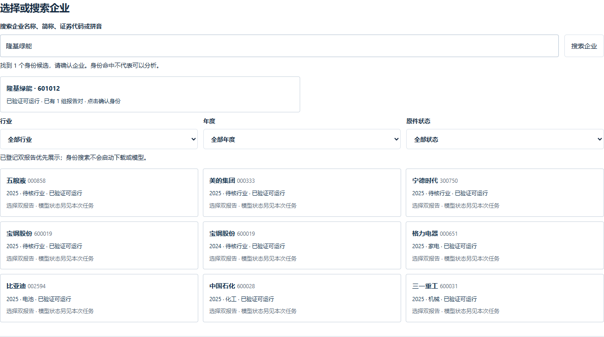
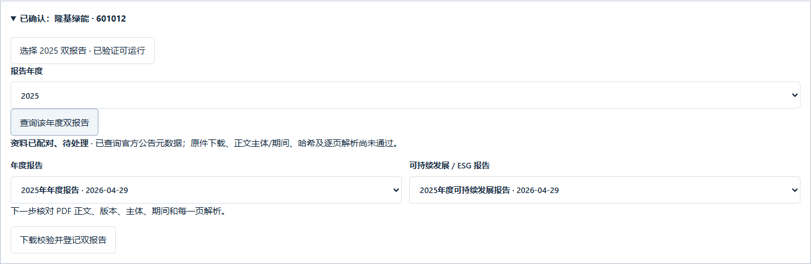
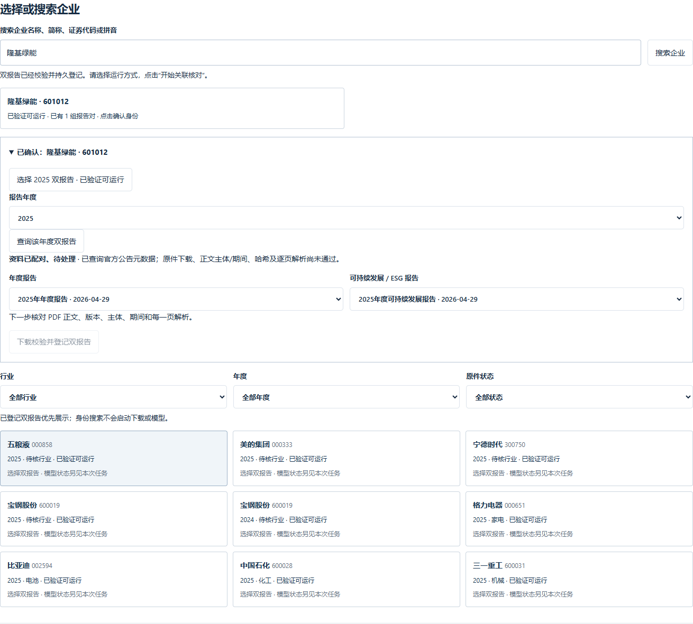
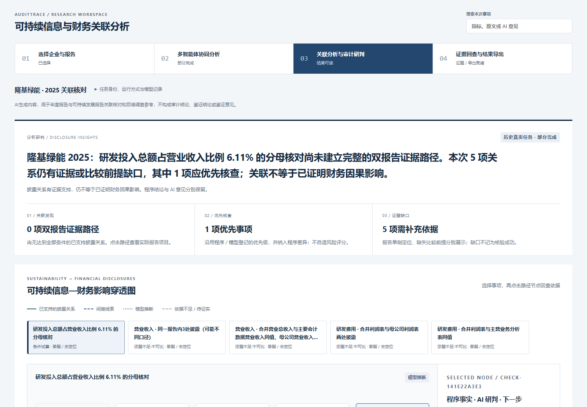

# 搜索与运行实际操作

本机正式入口 http://127.0.0.1:8893 。本轮新增隆基绿能在页面中完成“搜索 → 确认 601012 → 查询 2025 双报告 → 选择公告版本 → 后台校验并登记 → three_agents → 查看结果”。页面复验准备时复用本轮此前已经验证的同版本原件，没有把缓存命中称为重新下载。

真实任务：CONNJOB-33E6B1317078；run_id：CONN-54685C235D0148CF。真实模型调用 3 次，输入 157899、输出 18784 Token；状态 `three_agents_partial`。A3 返回后越过 12万已消费 Token 停止线，后续请求被阻止；这是一轮部分完成的真实试跑，绝不是完整三角色成功。实际人民币账单未核对，不把未知费用写成0。

最终浏览器复验覆盖名称、代码、全称、ljln、近似名称、未登记福耀玻璃、不存在的明确合成名称；身份候选需点击确认。中国神华仅找到年报时明确缺 ESG；未来年度返回422。切换企业不清空原任务；原页与 JSON/CSV/DOCX 导出均200，引用均属本企业。另从页面实际启动伊利的 calculation_only，零模型调用并得到程序结果。

1440×1000、1024×768、768×1024、390×844 均无横向溢出。公网登录与权限使用现有 Supabase 组织账号；身份搜索和已完成结果读取不等于拥有新下载或付费模型权限。本轮没有使用真人账号密码执行公网登录，相关 Cookie 和权限边界由隔离合同测试验证。
