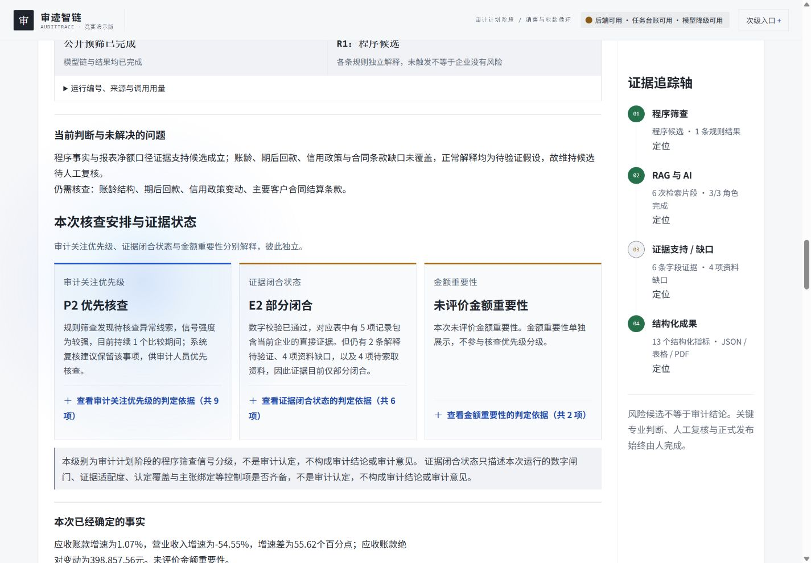

# 界面信息层级与折叠改造：执行与验收记录

执行日期：2026-10-11。实施基线：`8d77ae2`。本轮已完成前端实现及可执行的本地验收；PDF 排版和部分真实运行终态验收尚未完成，因此不将计划的全部完成条件勾为通过。

## 实际改动

| 内容 | 默认可见 | 展开后可见 |
|---|---|---|
| 当前判断 | 判断与未解决的问题 | 原运行记录 |
| 三个独立状态 | 审计关注优先级、证据闭合状态、金额重要性及各自解释 | 各级别的完整判定依据 |
| 事实与事项 | 关键数字、四个实际 PDF 页码入口、事项观察与限制 | 原表证据、完整草稿、主张、资料缺口 |
| 三角色协作 | 本次处理摘要及关键证据限制 | 全部角色输出与证据链 |
| 认定覆盖 | 全部认定的覆盖状态和程序编号 | 直接证据、缺口及原始完整记录 |
| 证据用途 | 证据类别、用途边界、语义支持待复核 | 分类说明及限制记录 |
| 反向检索 | 实际检索状态与一个正常解释 | 全部解释及问题记录 |
| 数字控制 | 实际可回查数量、未知数量或未通过状态 | 全部数字回查记录 |
| 下一步 | 资料与程序、补证入口 | 完整计划及计算表 |
| 来源与留痕 | 模块摘要，具体展开按钮在摘要下方 | 完整来源和模型留痕 |

修改文件为 `index.html`、`assets/official-v4/demo-app.js`、`assets/official-v4/styles.css`；新增 `scripts/check_ui_hierarchy.mjs`，并在 `.gitignore` 加入该脚本的单项保留规则。原有后台算法和专业等级合同保持不变，阅读摘要直接取自同一运行。历史恢复在结果状态中明确显示历史来源及本次新增零次模型调用。

额外修复：阅读已完成结果按钮不再与启动、重跑争夺主按钮；覆盖详情改用真实数据字段；缺失计数不显示为零；数字核查明确失败时不显示为未提供；反向解释列表采用有效列表结构。

## 已验证

- 当前 FastAPI 服务读取当前 HTML/JS/CSS，恢复真实历史任务 `DEMO-RUN-478070609368`，运行 `RUN-V7-DCF895BC5377`，五粮液，实际期间 2025/2024，来源截止 2026-04-30。这是历史运行的界面验收，不是本次代码的新模型链验收。
- 四视口 1440×1000、1024×768、768×1024、390×844 均保存并人工查看截图，无页面横向溢出。平板和手机等级卡采用单列；完整指标默认折叠。代表性详情展开截图为 `expanded-390.jpg`。
- 认定覆盖详情使用 Enter 展开、Space 收起；来源按钮同样可由键盘展开与收起，`aria-expanded` 随状态变化。
- 切换到标准股份后，上一案例的等级、PDF 链接、覆盖详情及展开状态清空，结果区隐藏。刷新可恢复同一真实历史任务。
- 结果区域 axe 扫描零违规项，原始报告为 `axe-result.json`；这不等于整站所有状态均通过无障碍验收。
- 原文入口跳转到对应巨潮年报及实际页码。浏览器 PDF 画面未能正常显示，因此仅确认跳转，不能认定阅读器画面验收通过。
- 从真实界面下载 JSON 与 CSV：JSON 的嵌入 `run` 与历史原始结果完全一致；CSV 28 行均为同一 `run_id`，保留计算口径。详见 `export-network-check.json` 和实际下载文件。
- 本地记录的请求均为 GET/HEAD，无新建任务请求、无 HTTP 错误；浏览器采集到的警告与错误为空。验收服务拒绝写请求并阻断后端外部连接，不触发新的付费模型运行。
- `node --check assets/official-v4/demo-app.js`、前端契约检查、新增界面回归、变更文件 `git diff --check` 通过。契约保持 227 个唯一 ID、302 个引用、2 个脚本。Git 的 LF/CRLF 提示不影响检查结果。
- 新增回归覆盖原运行不被改写、真实覆盖证据字段、未知计数、缺失等级、无页码禁用入口、空结果清理、数字明确失败、打印全部展开及恢复原展开状态。
- 聚焦后端测试实际通过：`test_innovation_controls.py`、`test_planning_priority.py`、`test_evidence_closure.py`、`test_delivery_contract_fields.py`、`test_finals_support_boundaries.py`，共 76 passed、2 warnings。警告为 Starlette/httpx 弃用提示及 pytest 缓存目录权限提示。
- 本项目原生 HTML/JS/CSS 无适用的前端类型检查、构建及 Lint 工具链；未为此新增框架。

## 未完成及限制

1. 点击真实打印按钮后系统打印窗口打开，当前浏览器控制接口无法操作保存或取消，随后关闭本轮验收页恢复控制。未生成本次页面 PDF，也未人工验证分页。自动化已验证展开和恢复函数，但不替代真实打印取消后的页面检查。
2. 本轮真实浏览器验收覆盖历史成功结果、未运行及案例切换；没有新建模型任务，也没有在浏览器重演失败、取消、备用、不可比等所有终态。相关专业边界通过现有聚焦测试，但不能写成这些浏览器场景已实测。
3. 已核对键盘和文本状态；未实际切换系统减少动态效果设置进行复验。

实现验收阶段没有提交、推送或部署。随后用户授权提交 GitHub，本记录随界面代码提交；公网仍须按授权和正式验收单独处理。

## 证据与回退

本目录保留实施前四个文件副本和 Git 状态于 `baseline/`，四视口截图、展开截图、网络记录、无障碍报告、导出原件及比对。回退仅恢复本轮前端文件和必要测试改动；不得整仓 reset，不得恢复其他任务已删除的历史文档。隔离服务与测试辅助脚本只用于验收，未加入生产入口。

## GitHub 可复验材料

本记录从本地验收目录整理入库。完整本地目录 `outputs/ui-hierarchy-20261011/` 保持不入库，必要截图及检查摘要位于 `docs/review-assets/ui-hierarchy-20261011/`。上述基线和完整原始导出仍仅保存在本地。

新增脚本使用 `scripts/fixtures/ui_hierarchy_run.json`，该夹具从同一真实历史运行摘取测试所需字段，明确标为离线测试，不用于产品回放或新的模型验收。干净克隆后可直接运行 `node scripts/check_ui_hierarchy.mjs`。

